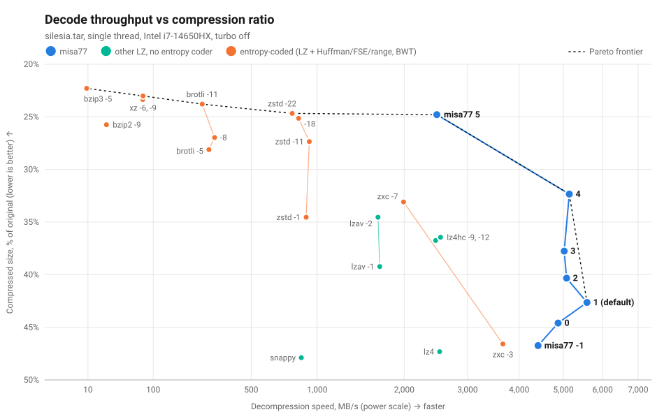
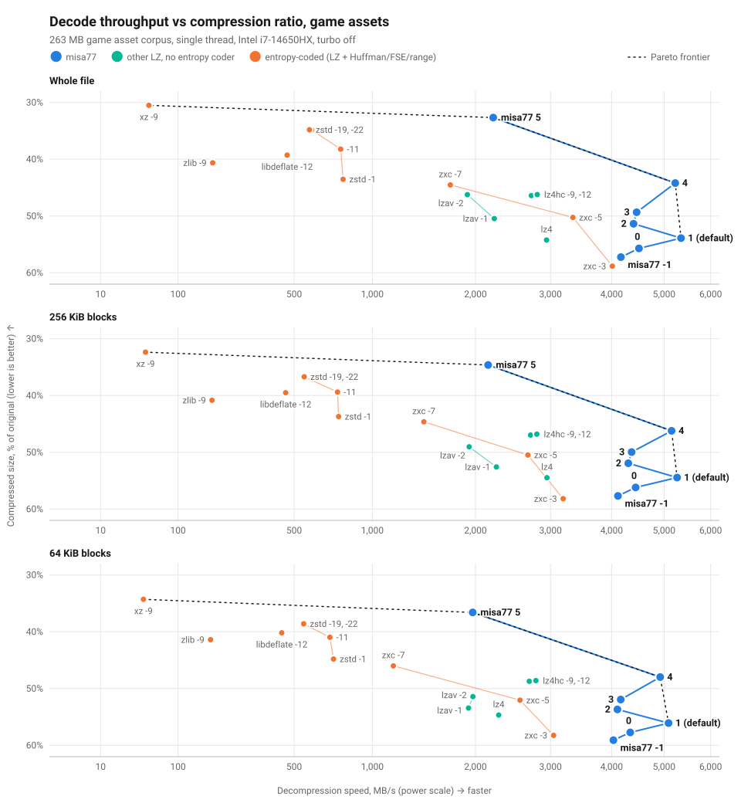

# misa77 (0.8.1)

misa77 is an LZ-based compressor that targets the write-once, read-many niche. In particular, it aims to satisfy the following criteria:

1. Extremely high decompression throughput (single-threaded, and in-memory).
2. Good compression ratios relative to decode throughput. For reference, misa77 levels that correspond to LZ4 and zstd-class ratios decode roughly 2 times faster than their counterparts respectively.
3. Constant memory use during compression, regardless of input size. No extra memory use during decompression (except at level 5, which needs 1.4 MB).

Slow compression is the obvious tradeoff that we make to achieve the above.

misa77 has seven compression effort levels as of v0.8.0. For most shapes of data, encode time increases and ratio decreases with increasing level, but decompression throughput is *not* similarly monotonic. In general, level 1 offers the fastest decode throughput. More information about effort levels can be found [here](#levels).

Decompression for all levels is always safe as of v0.8.0, i.e. the decompressor is guaranteed to exit gracefully (terminate, and not access out-of-bounds memory or engage in any other UB) in the case of corrupt/malicious input.

## Benchmarks

A terse summary of misa77's performance would be that relative to its competitors (LZ4 class codecs for levels -1 to 4, and zstd/brotli/xz for level 5), it encodes slower, gets similar ratios, but decodes *much* faster.

Some results on specific corpora follow. For more detailed and cross-platform results, see [BENCHMARKS.md](misc/BENCHMARKS.md).

The benchmarks below were run on the following setup:
- CPU: Intel(R) Core(TM) i7-14650HX (@2.2 GHz) (Intel Turbo disabled).
- Single threaded, pinned to a single performance core.
- CPU governor set to `performance`.

The benchmarking harness used was [lzbench](https://github.com/inikep/lzbench/). misa77 has also been merged into [TurboBench](https://github.com/powturbo/TurboBench), and the results below can be reproduced through both harnesses.

### Silesia Corpus

This corpus can be found [here](https://sun.aei.polsl.pl//~sdeor/corpus/silesia.zip). It contains 12 files, totaling 212 MB, covering text, source code, databases, executables, and medical images. It is the standard (albeit outdated) corpus for comparing general-purpose compressors.

<picture>
  <source media="(prefers-color-scheme: dark)" srcset="misc/lzbench-results-archive/0.8.0/decode_vs_ratio_dark.svg">
  
</picture>

The takeaway is that levels 1-4 dominate LZ4 (and other codecs in this class) on decode speed. Level 4 in particular gets smaller ratios, decodes ~2x faster (...and encodes much slower). Level 5 gets similar ratios to several high-effort codecs like zstd and xz, while decoding much faster.

<details>
<summary>Table: silesia.tar (Intel)</summary>

| Compressor name   | Compression | Decompress. | Ratio | Filename    |
| ----------------- | ----------- | ----------- | ----- | ----------- |
| misa77 0.8.0 --1  |    229 MB/s |   4412 MB/s | 46.74 | silesia.tar |
| misa77 0.8.0 -0   |    171 MB/s |   4875 MB/s | 44.60 | silesia.tar |
| **misa77 0.8.0 -1** | **54.2 MB/s** | **5588 MB/s** | **42.64** | silesia.tar |
| misa77 0.8.0 -2   |   41.4 MB/s |   5078 MB/s | 40.33 | silesia.tar |
| misa77 0.8.0 -3   |   10.6 MB/s |   5020 MB/s | 37.76 | silesia.tar |
| **misa77 0.8.0 -4** | **1.75 MB/s** | **5144 MB/s** | **32.34** | silesia.tar |
| **misa77 0.8.0 -5** | **0.85 MB/s** | **2485 MB/s** | **24.79** | silesia.tar |
| lz4 1.11.0        |    382 MB/s |   2530 MB/s | 47.32 | silesia.tar |
| lz4hc 1.11.0 -9   |   21.2 MB/s |   2466 MB/s | 36.75 | silesia.tar |
| lz4hc 1.11.0 -12  |   7.83 MB/s |   2544 MB/s | 36.45 | silesia.tar |
| zxc 1.0.0 -3      |    122 MB/s |   3667 MB/s | 46.59 | silesia.tar |
| zxc 1.0.0 -7      |   5.09 MB/s |   1991 MB/s | 33.09 | silesia.tar |
| lzav 7.2 -1       |    331 MB/s |   1677 MB/s | 39.23 | silesia.tar |
| lzav 7.2 -2       |   64.0 MB/s |   1655 MB/s | 34.54 | silesia.tar |
| snappy 1.3.1      |    300 MB/s |    861 MB/s | 47.89 | silesia.tar |
| zstd 1.5.7 -1     |    297 MB/s |    902 MB/s | 34.54 | silesia.tar |
| zstd 1.5.7 -11    |   25.1 MB/s |    929 MB/s | 27.35 | silesia.tar |
| zstd 1.5.7 -18    |   2.67 MB/s |    838 MB/s | 25.14 | silesia.tar |
| zstd 1.5.7 -22    |   1.39 MB/s |    786 MB/s | 24.67 | silesia.tar |
| brotli 1.2.0 -5   |   38.4 MB/s |    282 MB/s | 28.11 | silesia.tar |
| brotli 1.2.0 -8   |   9.67 MB/s |    307 MB/s | 26.96 | silesia.tar |
| brotli 1.2.0 -11  |   0.41 MB/s |    254 MB/s | 23.79 | silesia.tar |
| xz 5.8.4 -6       |   2.15 MB/s |   77.7 MB/s | 23.35 | silesia.tar |
| xz 5.8.4 -9       |   1.85 MB/s |   78.2 MB/s | 23.01 | silesia.tar |
| bzip3 1.5.4 -5    |   9.19 MB/s |   9.30 MB/s | 22.29 | silesia.tar |
| bzip2 1.0.8 -9    |   8.97 MB/s |   24.4 MB/s | 25.75 | silesia.tar |

</details>

### Game Asset Corpus

There's no standard corpus for this, so I unwrapped the archives of some games (14 games, using 12 different engines), and put together a corpus containing the following data types: textures (33 %), geometry (15 %), levels (14 %), engine packages (13 %), other raster data (10 %), text and tables (9 %) and animation (6 %). It's about 263 MB, and games usually compress data in small independent blocks, so I've included results at 256 KiB and 64 KiB block framings.

<picture>
  <source media="(prefers-color-scheme: dark)" srcset="misc/lzbench-results-archive/0.8.0/decode_vs_ratio_game_dark.svg">
  
</picture>

The takeaways are quite similar to those for silesia, except that level 5 gets better ratios than codecs like zstd here. Also, the relative placement of codecs here is not that sensitive to blocked framing (although their absolute ratios do worsen as block size reduces).

<details>
<summary>Table: game asset corpus, whole file (Intel)</summary>

| Compressor name   | Compression | Decompress. | Compr. size | Ratio |
| ----------------- | ----------- | ----------- | ----------- | ----- |
| misa77 0.8.0 --1  |    320 MB/s |   4167 MB/s |   150705323 | 57.24 |
| misa77 0.8.0 -0   |    224 MB/s |   4503 MB/s |   146655971 | 55.70 |
| **misa77 0.8.0 -1** | **54.2 MB/s** | **5351 MB/s** | **141927907** | **53.90** |
| misa77 0.8.0 -2   |   35.2 MB/s |   4401 MB/s |   135244018 | 51.36 |
| misa77 0.8.0 -3   |   10.9 MB/s |   4459 MB/s |   129910358 | 49.34 |
| **misa77 0.8.0 -4** | **1.91 MB/s** | **5228 MB/s** | **116372402** | **44.20** |
| **misa77 0.8.0 -5** | **0.98 MB/s** | **2214 MB/s** | **86010625** | **32.67** |
| lz4 1.11.0        |    533 MB/s |   2941 MB/s |   142823813 | 54.24 |
| lz4hc 1.11.0 -9   |   23.7 MB/s |   2721 MB/s |   122165338 | 46.40 |
| lz4hc 1.11.0 -12  |   6.70 MB/s |   2805 MB/s |   121732829 | 46.23 |
| zstd 1.5.7 -1     |    360 MB/s |    789 MB/s |   114616340 | 43.53 |
| zstd 1.5.7 -11    |   34.4 MB/s |    773 MB/s |   100651951 | 38.23 |
| zstd 1.5.7 -19    |   3.51 MB/s |    595 MB/s |    91747266 | 34.84 |
| zstd 1.5.7 -22    |   2.21 MB/s |    582 MB/s |    91643641 | 34.81 |
| zlib 1.4 -9       |   4.27 MB/s |    182 MB/s |   106990390 | 40.63 |
| libdeflate 1.26 -12 |   4.17 MB/s |    465 MB/s |   103400315 | 39.27 |
| xz 5.8.4 -9       |   2.45 MB/s |   52.7 MB/s |    80312924 | 30.50 |
| lzav 7.2 -1       |    501 MB/s |   2228 MB/s |   132868680 | 50.46 |
| lzav 7.2 -2       |   83.2 MB/s |   1906 MB/s |   121761787 | 46.24 |
| zxc 1.0.0 -3      |    184 MB/s |   4012 MB/s |   154902064 | 58.83 |
| zxc 1.0.0 -5      |   57.8 MB/s |   3346 MB/s |   132312231 | 50.25 |
| zxc 1.0.0 -7      |   7.24 MB/s |   1717 MB/s |   117229590 | 44.52 |

</details>

<details>
<summary>Table: game asset corpus, 256 KiB blocks (Intel)</summary>

| Compressor name   | Compression | Decompress. | Compr. size | Ratio |
| ----------------- | ----------- | ----------- | ----------- | ----- |
| misa77 0.8.0 --1  |    331 MB/s |   4113 MB/s |   151897710 | 57.69 |
| misa77 0.8.0 -0   |    232 MB/s |   4441 MB/s |   147958474 | 56.19 |
| **misa77 0.8.0 -1** | **57.1 MB/s** | **5267 MB/s** | **143356524** | **54.45** |
| misa77 0.8.0 -2   |   36.6 MB/s |   4303 MB/s |   136732102 | 51.93 |
| misa77 0.8.0 -3   |   10.0 MB/s |   4364 MB/s |   131565676 | 49.97 |
| **misa77 0.8.0 -4** | **2.59 MB/s** | **5153 MB/s** | **121713088** | **46.23** |
| **misa77 0.8.0 -5** | **1.08 MB/s** | **2151 MB/s** | **91164732** | **34.62** |
| lz4 1.11.0        |    539 MB/s |   2947 MB/s |   143456810 | 54.48 |
| lz4hc 1.11.0 -9   |   25.2 MB/s |   2710 MB/s |   123672012 | 46.97 |
| lz4hc 1.11.0 -12  |   7.28 MB/s |   2799 MB/s |   123260887 | 46.81 |
| zstd 1.5.7 -1     |    343 MB/s |    759 MB/s |   115076662 | 43.71 |
| zstd 1.5.7 -11    |   19.4 MB/s |    752 MB/s |   103735709 | 39.40 |
| zstd 1.5.7 -19    |   3.71 MB/s |    553 MB/s |    96663587 | 36.71 |
| zstd 1.5.7 -22    |   2.96 MB/s |    553 MB/s |    96651131 | 36.71 |
| zlib 1.4 -9       |   4.45 MB/s |    180 MB/s |   107525194 | 40.84 |
| libdeflate 1.26 -12 |   4.13 MB/s |    458 MB/s |   104033438 | 39.51 |
| xz 5.8.4 -9       |   2.35 MB/s |   48.3 MB/s |    85225544 | 32.37 |
| lzav 7.2 -1       |    491 MB/s |   2254 MB/s |   138471611 | 52.59 |
| lzav 7.2 -2       |    112 MB/s |   1926 MB/s |   129111210 | 49.04 |
| zxc 1.0.0 -3      |    185 MB/s |   3192 MB/s |   153199994 | 58.18 |
| zxc 1.0.0 -5      |   59.9 MB/s |   2672 MB/s |   132924513 | 50.48 |
| zxc 1.0.0 -7      |   7.30 MB/s |   1448 MB/s |   117520179 | 44.63 |

</details>

<details>
<summary>Table: game asset corpus, 64 KiB blocks (Intel)</summary>

| Compressor name   | Compression | Decompress. | Compr. size | Ratio |
| ----------------- | ----------- | ----------- | ----------- | ----- |
| misa77 0.8.0 --1  |    337 MB/s |   4031 MB/s |   155591506 | 59.09 |
| misa77 0.8.0 -0   |    234 MB/s |   4338 MB/s |   152016556 | 57.73 |
| **misa77 0.8.0 -1** | **56.7 MB/s** | **5089 MB/s** | **147655908** | **56.08** |
| misa77 0.8.0 -2   |   35.5 MB/s |   4103 MB/s |   141329601 | 53.68 |
| misa77 0.8.0 -3   |   12.4 MB/s |   4164 MB/s |   136723427 | 51.93 |
| **misa77 0.8.0 -4** | **2.79 MB/s** | **4919 MB/s** | **126321138** | **47.98** |
| **misa77 0.8.0 -5** | **1.25 MB/s** | **1967 MB/s** | **96355195** | **36.60** |
| lz4 1.11.0        |    442 MB/s |   2283 MB/s |   143943797 | 54.67 |
| lz4hc 1.11.0 -9   |   31.5 MB/s |   2692 MB/s |   128308752 | 48.73 |
| lz4hc 1.11.0 -12  |   9.83 MB/s |   2786 MB/s |   127965091 | 48.60 |
| zstd 1.5.7 -1     |    349 MB/s |    726 MB/s |   117956147 | 44.80 |
| zstd 1.5.7 -11    |   23.0 MB/s |    703 MB/s |   107866597 | 40.97 |
| zstd 1.5.7 -19    |   3.42 MB/s |    550 MB/s |   101658046 | 38.61 |
| zstd 1.5.7 -22    |   2.53 MB/s |    550 MB/s |   101633314 | 38.60 |
| zlib 1.4 -9       |   5.12 MB/s |    176 MB/s |   109015280 | 41.40 |
| libdeflate 1.26 -12 |   4.27 MB/s |    439 MB/s |   105794683 | 40.18 |
| xz 5.8.4 -9       |   1.48 MB/s |   45.7 MB/s |    90293872 | 34.29 |
| lzav 7.2 -1       |    460 MB/s |   1919 MB/s |   140685930 | 53.43 |
| lzav 7.2 -2       |    122 MB/s |   1970 MB/s |   135399817 | 51.42 |
| zxc 1.0.0 -3      |    228 MB/s |   3046 MB/s |   153341815 | 58.24 |
| zxc 1.0.0 -5      |   77.7 MB/s |   2564 MB/s |   137049655 | 52.05 |
| zxc 1.0.0 -7      |   7.81 MB/s |   1171 MB/s |   121146254 | 46.01 |

</details>

## Levels

TLDR: I recommend using one of levels 1, 4, or 5 depending on your requirements.

Levels are ordered by compression effort. For most shapes of data, encode time increases and ratio decreases with increasing level, but decompression throughput is *not* similarly monotonic.

| Level | Description                                             | Ratio | Encode vs L1 | Decode vs L1 | Encoder memory | Format |
| ----- | ------------------------------------------------------- | ----- | ------------ | ------------ | -------------- | ------ |
| -1    | fastest compression (not recommended as slow to decode) | 46.74 | 4.2x         | 79%          | 1 MB           | light  |
| 0     | fast compression, lz4-class ratio                       | 44.60 | 3.2x         | 87%          | 1 MB           | light  |
| **1**     | **default, fastest decode**                                 | 42.64 | 1x           | 100%         | 3 MB           | light  |
| 2     | better ratio, still cheap to encode                     | 40.33 | 0.76x        | 91%          | 3 MB           | light  |
| 3     | best ratio in the light format                          | 37.76 | 0.20x        | 90%          | 29 MB          | light  |
| **4**     | **best ratio without entropy coding**                       | 32.34 | 0.03x        | 92%          | 71 MB          | heavy  |
| **5**     | **best ratio overall (entropy-coded)**                      | 24.79 | 0.016x       | 44%          | 164 MB         | entropy |

- `Ratio` is as measured on `silesia.tar` in the [Intel run](#silesia-corpus).
- The `Encode`/`Decode vs L1` columns are throughput relative to level 1, from the same run.
- Levels -1 to 3 emit the light format, level 4 emits the heavy format and level 5 emits the entropy format (see [`docs/format.md`](docs/format.md)).
- `Encoder memory` is the compressor's own working state (disjoint from the caller's input and output buffers).  Levels 3 to 5 need less for inputs smaller than their internal block or window, as described in [`docs/format.md`](docs/format.md) (level 5 uses about 11 MB for a 64 KB input and 50 MB for a 1 MB input).
- Decompression needs no working memory at levels -1 to 4, and level 5's decoder allocates 1.4 MB of scratch space per call.

## Requirements

For the library:

- A C++20 compiler (both GCC and Clang are fine).
- CMake >= 3.20.
- A little-endian 64-bit system.

For the CLI:

- The `misa` CLI needs POSIX (Linux, macOS).

Note: On x86-64, AVX2/SSE2 are selected at runtime. ARM has a NEON path. On x86-64 and ARM64 with GCC or Clang, the decoders use hand-written assembly kernels (you can pass `-DMISA77_ASM=OFF` to use the C++ decoders instead, but I *strongly* recommend not doing this).

## Building

```sh
cmake -B build -DCMAKE_BUILD_TYPE=Release
cmake --build build
```

This produces the `misa` CLI at `build/misa`. For a binary tuned to the machine you'll run it on, add `-DMISA77_MARCH=native` (I recommend this). To run the round-trip test:

```sh
ctest --test-dir build
```

## Library Usage

The build produces a static library (CMake target `misa77::misa77`) with a small C++ API in `misa77/misa77.h`. The easiest integration is a git submodule (or CMake `FetchContent`) plus:

```cmake
add_subdirectory(misa77)
target_link_libraries(your_app PRIVATE misa77::misa77)
```

Alternatively, install it (`cmake --install build --prefix <dir>`) and use:

```cmake
find_package(misa77 REQUIRED)
target_link_libraries(your_app PRIVATE misa77::misa77)
```

Pass `-DMISA77_BUILD_CLI=OFF` if you only want the library.

Sample usage:

```cpp
#include <misa77/misa77.h>
#include <vector>

// compress (pick a level with misa77::config(N) with N in [-1, 5], default is 1), returns 0 on failure
misa77::config cfg;
std::vector<uint8_t> compressed(misa77::compress_bound(input_size, cfg));
uint64_t csize = misa77::compress(input, input_size, compressed.data(), compressed.size(), cfg);
compressed.resize(csize);

// decompress, returns original_size on success
uint64_t original_size = misa77::decompressed_size(compressed.data());
std::vector<uint8_t> output(misa77::decompressed_buffer_bound(original_size));
// returns 0 on invalid input
uint64_t written = misa77::decompress(compressed.data(), csize, output.data(), output.size());
```

Two things to keep in mind:

- You must size the destination buffers with `compress_bound` / `decompressed_buffer_bound`, passing `compress_bound` the same `config` you compress with (the bound depends on the level's format).
- The size you pass to `misa77::decompress` must be the exact size of the compressed stream (what `compress` returned), and not the size of the buffer holding it.

The experimental modes are declared in `misa77/experimental.h`, with usage documented in comments (these keep changing frequently so I don't wanna "formally" document them here just yet). You probably shouldn't be using them anyway.

## CLI Usage

`misa` is a single, dependency-free binary with two file-based subcommands, and a benchmark mode. It operates on single files only (there's no directory or pipe support, so `tar` first if you need those).

```sh
misa compress   FILE          # -> FILE.misa77
misa decompress FILE.misa77   # -> FILE
```

`misa compress` takes `-l N` / `--level N` to pick the compression level (default is 1). Everywhere, `-o PATH` sets the output path and `-f` overwrites without asking.

```sh
misa compress -l 0 enwik8                # enwik8 -> enwik8.misa77
misa decompress enwik8.misa77 -f         # back to enwik8
```

`misa bench FILE` compresses and decompresses a file in memory, and prints the sizes and throughput of each level (nothing is written to disk). `-l N` or `-l A:B` restricts it to one level or a range of levels, and `-t SECONDS` sets how long decompression is timed for at each level (default 3). Compression is timed over a single pass (as it's quite slow anyway), and decompression over the fastest of multiple passes.

```sh
$ misa bench -l 4:5 silesia.tar
 4#silesia.tar    :  211957760 ->   68541695 ( 32.34%),  1.74 MB/s,  5191 MB/s
 5#silesia.tar    :  211957760 ->   52549203 ( 24.79%),  0.83 MB/s,  2479 MB/s
```

## Documentation

The underlying stream formats (used by the library functions) and the container format for `.misa77` files (produced by the CLI) can be found in [`docs/`](docs/).

## Status

1. misa77's format may change unexpectedly as it's still v0.x.y.
2. It's been through local fuzzing with ASan/UBSan, broader hardening is ongoing.

Note: misa77 has evolved out of a less polished endeavour to learn performance engineering, and its history can be found [in this archived repository](https://github.com/welcome-to-the-sunny-side/misa77-archive).

## Acknowledgement

Inspiration has been taken from:

- [LZ4](http://github.com/lz4/lz4/)
- [lizard](https://github.com/inikep/lizard)
- [m77rip](https://github.com/paddor/m77rip)
- Various people on encode.su

Lastly, the following models helped a *lot* with every step of the process, including independently suggesting ideas/techniques that I wouldn't have thought of. Without their assistance, development would have been far slower, and I would likely not have explored all the paths that I did end up exploring (some of which were productive and some of which weren't).

- Claude Opus 4.8
- Claude Fable 5
- Claude Opus 5
- Claude Opus 5.5
- Claude Fable 5.2

## License

MIT (see [LICENSE](LICENSE)).