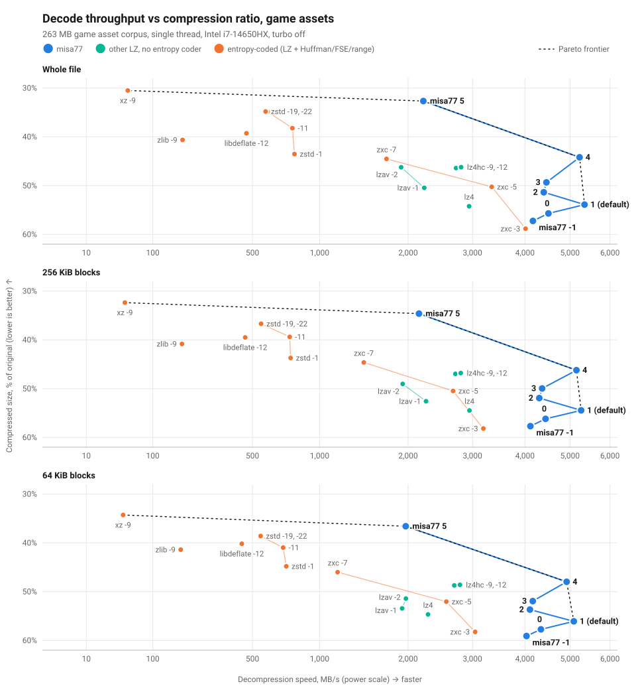

## Cross-Platform Results

Let's first see some cross-platform results for the [Silesia Corpus](https://sun.aei.polsl.pl//~sdeor/corpus/silesia.zip).

Note:

1. "Ratio" ahead is equal to `((compressed size)/(original)) * 100` (so lower is better).
2. misa77 has been merged into [lzbench](https://github.com/inikep/lzbench/) and [TurboBench](https://github.com/powturbo/TurboBench). The results below have been produced using lzbench, and can be reproduced through both benchmarking harnesses.
3. In the tables ahead, rows are grouped by codec family, and ordered from lowest to highest effort level within each family. The recommended misa77 levels are in bold.

---

### Intel x86-64

Details:

- CPU: Intel(R) Core(TM) i7-14650HX (@2.2 GHz) (Intel Turbo disabled).
- Single threaded, pinned to a single performance core.
- CPU governor set to `performance`.

| Compressor name   | Compression | Decompress. | Ratio | Filename    |
| ----------------- | ----------- | ----------- | ----- | ----------- |
| misa77 0.8.0 --1  |    229 MB/s |   4412 MB/s | 46.74 | silesia.tar |
| misa77 0.8.0 -0   |    171 MB/s |   4875 MB/s | 44.60 | silesia.tar |
| **misa77 0.8.0 -1** | **54.2 MB/s** | **5588 MB/s** | **42.64** | silesia.tar |
| misa77 0.8.0 -2   |   41.4 MB/s |   5078 MB/s | 40.33 | silesia.tar |
| misa77 0.8.0 -3   |   10.6 MB/s |   5020 MB/s | 37.76 | silesia.tar |
| **misa77 0.8.0 -4** | **1.75 MB/s** | **5144 MB/s** | **32.34** | silesia.tar |
| **misa77 0.8.0 -5** | **0.85 MB/s** | **2485 MB/s** | **24.79** | silesia.tar |
| lz4 1.11.0        |    382 MB/s |   2530 MB/s | 47.32 | silesia.tar |
| lz4hc 1.11.0 -9   |   21.2 MB/s |   2466 MB/s | 36.75 | silesia.tar |
| lz4hc 1.11.0 -12  |   7.83 MB/s |   2544 MB/s | 36.45 | silesia.tar |
| zxc 1.0.0 -3      |    122 MB/s |   3667 MB/s | 46.59 | silesia.tar |
| zxc 1.0.0 -7      |   5.09 MB/s |   1991 MB/s | 33.09 | silesia.tar |
| lzav 7.2 -1       |    331 MB/s |   1677 MB/s | 39.23 | silesia.tar |
| lzav 7.2 -2       |   64.0 MB/s |   1655 MB/s | 34.54 | silesia.tar |
| snappy 1.3.1      |    300 MB/s |    861 MB/s | 47.89 | silesia.tar |
| zstd 1.5.7 -1     |    297 MB/s |    902 MB/s | 34.54 | silesia.tar |
| zstd 1.5.7 -11    |   25.1 MB/s |    929 MB/s | 27.35 | silesia.tar |
| zstd 1.5.7 -18    |   2.67 MB/s |    838 MB/s | 25.14 | silesia.tar |
| zstd 1.5.7 -22    |   1.39 MB/s |    786 MB/s | 24.67 | silesia.tar |
| brotli 1.2.0 -5   |   38.4 MB/s |    282 MB/s | 28.11 | silesia.tar |
| brotli 1.2.0 -8   |   9.67 MB/s |    307 MB/s | 26.96 | silesia.tar |
| brotli 1.2.0 -11  |   0.41 MB/s |    254 MB/s | 23.79 | silesia.tar |
| xz 5.8.4 -6       |   2.15 MB/s |   77.7 MB/s | 23.35 | silesia.tar |
| xz 5.8.4 -9       |   1.85 MB/s |   78.2 MB/s | 23.01 | silesia.tar |
| bzip3 1.5.4 -5    |   9.19 MB/s |   9.30 MB/s | 22.29 | silesia.tar |
| bzip2 1.0.8 -9    |   8.97 MB/s |   24.4 MB/s | 25.75 | silesia.tar |

---

### Apple M4 Pro (ARM64)

Details:

- CPU: Apple M4 Pro.
- Single threaded.

| Compressor name   | Compression | Decompress. | Ratio | Filename    |
| ----------------- | ----------- | ----------- | ----- | ----------- |
| misa77 0.8.0 --1  |    620 MB/s |  13182 MB/s | 46.74 | silesia.tar |
| misa77 0.8.0 -0   |    431 MB/s |  15123 MB/s | 44.60 | silesia.tar |
| **misa77 0.8.0 -1** | **153 MB/s** | **16409 MB/s** | **42.64** | silesia.tar |
| misa77 0.8.0 -2   |    116 MB/s |  14180 MB/s | 40.33 | silesia.tar |
| misa77 0.8.0 -3   |   19.7 MB/s |  13313 MB/s | 37.76 | silesia.tar |
| **misa77 0.8.0 -4** | **4.24 MB/s** | **13778 MB/s** | **32.34** | silesia.tar |
| **misa77 0.8.0 -5** | **2.20 MB/s** | **6419 MB/s** | **24.70** | silesia.tar |
| lz4 1.11.0        |   1049 MB/s |   6889 MB/s | 47.32 | silesia.tar |
| lz4hc 1.11.0 -9   |   55.4 MB/s |   6528 MB/s | 36.75 | silesia.tar |
| lz4hc 1.11.0 -12  |   20.4 MB/s |   6557 MB/s | 36.45 | silesia.tar |
| zxc 1.0.0 -3      |    296 MB/s |  12596 MB/s | 46.59 | silesia.tar |
| zxc 1.0.0 -7      |   11.9 MB/s |   6389 MB/s | 33.09 | silesia.tar |
| lzav 7.2 -1       |    792 MB/s |   5002 MB/s | 39.23 | silesia.tar |
| lzav 7.2 -2       |    208 MB/s |   4974 MB/s | 34.54 | silesia.tar |
| snappy 1.3.1      |    802 MB/s |   4202 MB/s | 47.89 | silesia.tar |
| zstd 1.5.7 -1     |    775 MB/s |   1843 MB/s | 34.54 | silesia.tar |
| zstd 1.5.7 -11    |   65.5 MB/s |   1964 MB/s | 27.35 | silesia.tar |
| zstd 1.5.7 -18    |   6.81 MB/s |   1775 MB/s | 25.14 | silesia.tar |
| zstd 1.5.7 -22    |   3.49 MB/s |   1731 MB/s | 24.67 | silesia.tar |
| brotli 1.2.0 -5   |    103 MB/s |    655 MB/s | 28.10 | silesia.tar |
| brotli 1.2.0 -8   |   34.1 MB/s |    731 MB/s | 26.96 | silesia.tar |
| brotli 1.2.0 -11  |   0.97 MB/s |    608 MB/s | 23.78 | silesia.tar |
| xz 5.8.4 -6       |   5.32 MB/s |    152 MB/s | 23.35 | silesia.tar |
| xz 5.8.4 -9       |   4.33 MB/s |    154 MB/s | 23.01 | silesia.tar |
| bzip3 1.5.4 -5    |   14.5 MB/s |   23.0 MB/s | 22.29 | silesia.tar |
| bzip2 1.0.8 -9    |   22.4 MB/s |   70.0 MB/s | 25.75 | silesia.tar |

---

Results on AMD x86-64 will be added soon.

---

## Game Asset Corpus

There's no standard corpus for this, so I unwrapped the archives of some games (14 games, using 12 different engines), and put together a corpus (totalling 263 MB) containing the following data types: textures (33 %), geometry (15 %), levels (14 %), engine packages (13 %), other raster data (10 %), text and tables (9 %) and animation (6 %).

Games usually compress data in small independent blocks, so results are given for the whole file, and for 256 KiB and 64 KiB blocks. The block results use lzbench's `-b` option (`-b256`, `-b64`), which cuts the tar into fixed-size blocks and compresses and decompresses each block independently.

These results are from the Intel x86-64 machine described above.

<picture>
  <source media="(prefers-color-scheme: dark)" srcset="lzbench-results-archive/0.8.0/decode_vs_ratio_game_dark.svg">
  
</picture>

### Whole file

| Compressor name   | Compression | Decompress. | Compr. size | Ratio |
| ----------------- | ----------- | ----------- | ----------- | ----- |
| misa77 0.8.0 --1  |    320 MB/s |   4167 MB/s |   150705323 | 57.24 |
| misa77 0.8.0 -0   |    224 MB/s |   4503 MB/s |   146655971 | 55.70 |
| **misa77 0.8.0 -1** | **54.2 MB/s** | **5351 MB/s** | **141927907** | **53.90** |
| misa77 0.8.0 -2   |   35.2 MB/s |   4401 MB/s |   135244018 | 51.36 |
| misa77 0.8.0 -3   |   10.9 MB/s |   4459 MB/s |   129910358 | 49.34 |
| **misa77 0.8.0 -4** | **1.91 MB/s** | **5228 MB/s** | **116372402** | **44.20** |
| **misa77 0.8.0 -5** | **0.98 MB/s** | **2214 MB/s** | **86010625** | **32.67** |
| lz4 1.11.0        |    533 MB/s |   2941 MB/s |   142823813 | 54.24 |
| lz4hc 1.11.0 -9   |   23.7 MB/s |   2721 MB/s |   122165338 | 46.40 |
| lz4hc 1.11.0 -12  |   6.70 MB/s |   2805 MB/s |   121732829 | 46.23 |
| zstd 1.5.7 -1     |    360 MB/s |    789 MB/s |   114616340 | 43.53 |
| zstd 1.5.7 -11    |   34.4 MB/s |    773 MB/s |   100651951 | 38.23 |
| zstd 1.5.7 -19    |   3.51 MB/s |    595 MB/s |    91747266 | 34.84 |
| zstd 1.5.7 -22    |   2.21 MB/s |    582 MB/s |    91643641 | 34.81 |
| zlib 1.4 -9       |   4.27 MB/s |    182 MB/s |   106990390 | 40.63 |
| libdeflate 1.26 -12 |   4.17 MB/s |    465 MB/s |   103400315 | 39.27 |
| xz 5.8.4 -9       |   2.45 MB/s |   52.7 MB/s |    80312924 | 30.50 |
| lzav 7.2 -1       |    501 MB/s |   2228 MB/s |   132868680 | 50.46 |
| lzav 7.2 -2       |   83.2 MB/s |   1906 MB/s |   121761787 | 46.24 |
| zxc 1.0.0 -3      |    184 MB/s |   4012 MB/s |   154902064 | 58.83 |
| zxc 1.0.0 -5      |   57.8 MB/s |   3346 MB/s |   132312231 | 50.25 |
| zxc 1.0.0 -7      |   7.24 MB/s |   1717 MB/s |   117229590 | 44.52 |

### 256 KiB blocks

| Compressor name   | Compression | Decompress. | Compr. size | Ratio |
| ----------------- | ----------- | ----------- | ----------- | ----- |
| misa77 0.8.0 --1  |    331 MB/s |   4113 MB/s |   151897710 | 57.69 |
| misa77 0.8.0 -0   |    232 MB/s |   4441 MB/s |   147958474 | 56.19 |
| **misa77 0.8.0 -1** | **57.1 MB/s** | **5267 MB/s** | **143356524** | **54.45** |
| misa77 0.8.0 -2   |   36.6 MB/s |   4303 MB/s |   136732102 | 51.93 |
| misa77 0.8.0 -3   |   10.0 MB/s |   4364 MB/s |   131565676 | 49.97 |
| **misa77 0.8.0 -4** | **2.59 MB/s** | **5153 MB/s** | **121713088** | **46.23** |
| **misa77 0.8.0 -5** | **1.08 MB/s** | **2151 MB/s** | **91164732** | **34.62** |
| lz4 1.11.0        |    539 MB/s |   2947 MB/s |   143456810 | 54.48 |
| lz4hc 1.11.0 -9   |   25.2 MB/s |   2710 MB/s |   123672012 | 46.97 |
| lz4hc 1.11.0 -12  |   7.28 MB/s |   2799 MB/s |   123260887 | 46.81 |
| zstd 1.5.7 -1     |    343 MB/s |    759 MB/s |   115076662 | 43.71 |
| zstd 1.5.7 -11    |   19.4 MB/s |    752 MB/s |   103735709 | 39.40 |
| zstd 1.5.7 -19    |   3.71 MB/s |    553 MB/s |    96663587 | 36.71 |
| zstd 1.5.7 -22    |   2.96 MB/s |    553 MB/s |    96651131 | 36.71 |
| zlib 1.4 -9       |   4.45 MB/s |    180 MB/s |   107525194 | 40.84 |
| libdeflate 1.26 -12 |   4.13 MB/s |    458 MB/s |   104033438 | 39.51 |
| xz 5.8.4 -9       |   2.35 MB/s |   48.3 MB/s |    85225544 | 32.37 |
| lzav 7.2 -1       |    491 MB/s |   2254 MB/s |   138471611 | 52.59 |
| lzav 7.2 -2       |    112 MB/s |   1926 MB/s |   129111210 | 49.04 |
| zxc 1.0.0 -3      |    185 MB/s |   3192 MB/s |   153199994 | 58.18 |
| zxc 1.0.0 -5      |   59.9 MB/s |   2672 MB/s |   132924513 | 50.48 |
| zxc 1.0.0 -7      |   7.30 MB/s |   1448 MB/s |   117520179 | 44.63 |

### 64 KiB blocks

| Compressor name   | Compression | Decompress. | Compr. size | Ratio |
| ----------------- | ----------- | ----------- | ----------- | ----- |
| misa77 0.8.0 --1  |    337 MB/s |   4031 MB/s |   155591506 | 59.09 |
| misa77 0.8.0 -0   |    234 MB/s |   4338 MB/s |   152016556 | 57.73 |
| **misa77 0.8.0 -1** | **56.7 MB/s** | **5089 MB/s** | **147655908** | **56.08** |
| misa77 0.8.0 -2   |   35.5 MB/s |   4103 MB/s |   141329601 | 53.68 |
| misa77 0.8.0 -3   |   12.4 MB/s |   4164 MB/s |   136723427 | 51.93 |
| **misa77 0.8.0 -4** | **2.79 MB/s** | **4919 MB/s** | **126321138** | **47.98** |
| **misa77 0.8.0 -5** | **1.25 MB/s** | **1967 MB/s** | **96355195** | **36.60** |
| lz4 1.11.0        |    442 MB/s |   2283 MB/s |   143943797 | 54.67 |
| lz4hc 1.11.0 -9   |   31.5 MB/s |   2692 MB/s |   128308752 | 48.73 |
| lz4hc 1.11.0 -12  |   9.83 MB/s |   2786 MB/s |   127965091 | 48.60 |
| zstd 1.5.7 -1     |    349 MB/s |    726 MB/s |   117956147 | 44.80 |
| zstd 1.5.7 -11    |   23.0 MB/s |    703 MB/s |   107866597 | 40.97 |
| zstd 1.5.7 -19    |   3.42 MB/s |    550 MB/s |   101658046 | 38.61 |
| zstd 1.5.7 -22    |   2.53 MB/s |    550 MB/s |   101633314 | 38.60 |
| zlib 1.4 -9       |   5.12 MB/s |    176 MB/s |   109015280 | 41.40 |
| libdeflate 1.26 -12 |   4.27 MB/s |    439 MB/s |   105794683 | 40.18 |
| xz 5.8.4 -9       |   1.48 MB/s |   45.7 MB/s |    90293872 | 34.29 |
| lzav 7.2 -1       |    460 MB/s |   1919 MB/s |   140685930 | 53.43 |
| lzav 7.2 -2       |    122 MB/s |   1970 MB/s |   135399817 | 51.42 |
| zxc 1.0.0 -3      |    228 MB/s |   3046 MB/s |   153341815 | 58.24 |
| zxc 1.0.0 -5      |   77.7 MB/s |   2564 MB/s |   137049655 | 52.05 |
| zxc 1.0.0 -7      |   7.81 MB/s |   1171 MB/s |   121146254 | 46.01 |